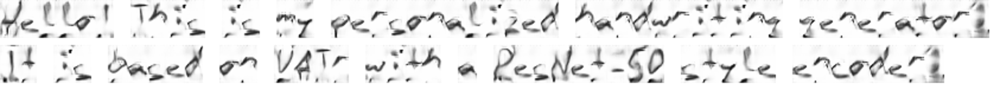

# ✍️ Personalized Handwriting Generator
### Deep Learning | VATr | ResNet-50 | PyTorch | Streamlit

<p align="center">
  <b>Generate realistic handwritten text in a writer's unique handwriting style using just 15 reference word images.</b>
</p>

---

## 🚀 Project Overview

The **Personalized Handwriting Generator** is a deep learning-based system that converts typed text into realistic handwritten images matching a specific writer's handwriting style.

The project implements **VATr (Visual Archetypes-based Transformer)** with a **ResNet-50 style encoder**, based on the CVPR 2023 research paper *Handwritten Text Generation from Visual Archetypes*.

The model is trained using the IAM Handwriting Database and supports handwriting generation for unseen writers using only 15 reference word images.

A Streamlit web application provides an interactive interface for generating personalized handwriting.

### ✨ Key Features

- **Personalized Handwriting:** Generate text in different handwriting styles.
- **Few-Shot Adaptation:** Requires only 15 reference word images.
- **Multiple Writers:** Supports handwriting styles from unseen writers.
- **Custom Text Generation:** Convert arbitrary typed text into handwriting.
- **Image Upload:** Upload handwritten pages or individual word images.
- **Adjustable Appearance:** Customize stroke variation, line width, and output appearance.
- **PNG Export:** Download generated handwriting images.
- **Readability Evaluation:** Includes a handwriting recognizer for readability checks.
- **Interactive Interface:** User-friendly Streamlit application.

---

## 🖥️ Application Preview

The application allows users to select a handwriting style, enter custom text, adjust generation settings and download the generated handwriting.

**Sample generated handwriting:**



---

## 🧠 Model Architecture

The project uses **VATr (Visual Archetypes-based Transformer)** with a ResNet-50-based style encoder.

### Main Components

| Component | Description |
|---|---|
| VATr | Handwritten text generation architecture |
| ResNet-50 | Writer style encoding |
| Transformer | Visual archetype-based text generation |
| CRNN Recognizer | Handwriting readability checking |
| IAM Database | Handwriting training dataset |
| Streamlit | Interactive web application |

### Model Checkpoints

Two generator versions are provided:

1. **Averaged Generator:** Average of step-24k and final weights. Recommended default.
2. **Best Generator:** Best checkpoint from step 24,000.

The application also includes a trained CRNN recognizer for readability evaluation.

---

## 🛠️ Technology Stack

| Category | Technologies |
|---|---|
| Programming Language | Python |
| Deep Learning | PyTorch, Torchvision |
| Model Architecture | VATr, ResNet-50 |
| Computer Vision | OpenCV, Pillow |
| Data Processing | NumPy, Pandas, SciPy |
| Evaluation | Scikit-learn, Scikit-image, GUDHI |
| Visualization | Matplotlib |
| Frontend | Streamlit |
| Development | Jupyter Notebook, Kaggle |
| Version Control | Git, Git LFS |

---

## 📊 Model Performance

The following results were obtained from Run 3 using the best checkpoint.

### Evaluation Metrics

| Metric | Unseen Writers | Seen Writers |
|---|---:|---:|
| Character Error Rate (CER) | 0.0055 | 0.0034 |
| Word Error Rate (WER) | 0.0218 | 0.0131 |
| FID | 51.08 | 53.34 |
| KID | 0.0246 | 0.0246 |
| Geometry Score | 0.0094 | 0.0045 |

Additional results:

- Writer Identification Accuracy: 50.9% (424 writers).
- Unseen Writer Retrieval: 71.1%.
- SSIM: 0.141 (unseen writers).

**Evaluation Note:** CER and writer identification metrics are measured using networks that also guided training and may therefore be optimistic. FID is not directly comparable with the original VATr paper because of differences in image resolution and training duration.

---

## 📁 Project Structure

```text
Personalized-Handwriting-Generator/
│
├── results/
│   ├── evaluation/
│   │   ├── metrics.csv
│   │   ├── metrics.json
│   │   ├── char_confusion_unseen.png
│   │   └── training_losses.png
│   │
│   ├── samples/
│   ├── my_handwriting.png
│   ├── recognizer.pt
│   ├── vatr_resnet50_generator.pt
│   └── vatr_resnet50_generator_avg.pt
│
├── streamlit_app/
│   ├── samples/
│   ├── app.py
│   ├── model.py
│   ├── README.txt
│   └── requirements.txt
│
├── dl-final-project.ipynb
├── Project_Summary.txt
├── README.md
├── requirements.txt
├── .gitignore
└── .gitattributes
```

Training caches and full training checkpoints are excluded from the Git repository.

---

## ⚙️ Installation and Setup

### Prerequisites

- Python 3.10, 3.11 or 3.12 (64-bit).
- Git.
- Git LFS.
- Sufficient disk space for model weights and dependencies.

CPU execution is supported. An NVIDIA GPU is used automatically when available.

### Step 1: Clone the Repository

Install Git LFS if you haven't already:

```bash
git lfs install
```

Clone the repository:

```bash
git clone https://github.com/ashishmuppalla14/Personalized-Handwriting-Generator.git
```

Navigate into the project:

```bash
cd Personalized-Handwriting-Generator
```

Download the actual trained model weights:

```bash
git lfs pull
```

**Important:** Git LFS is required to download the trained `.pt` model files. Without it, Git may download small pointer files instead of the actual model weights.

### Step 2: Create a Virtual Environment

```bash
python -m venv venv
```

Activate it on Windows:

```powershell
.\venv\Scripts\Activate.ps1
```

For Linux/macOS:

```bash
source venv/bin/activate
```

### Step 3: Install Dependencies

For the complete project:

```bash
pip install --upgrade pip
pip install -r requirements.txt
```

Alternatively, install only the application dependencies:

```bash
pip install -r streamlit_app/requirements.txt
```

### Step 4: Run the Application

From the project root directory:

```bash
streamlit run streamlit_app/app.py
```

Open your browser:

```text
http://localhost:8501
```

🎉 Your Personalized Handwriting Generator is ready!

---

## 🎨 How to Use the Application

1. Launch the Streamlit application.
2. Select a handwriting style from the available writers.
3. Alternatively, upload a handwritten page or individual word images.
4. Enter the text you want to convert into handwriting.
5. Adjust the random seed, stroke variation and line width.
6. Choose an appearance preset.
7. Click **Generate Handwriting**.
8. Preview the generated handwriting.
9. Download the output as a PNG image.

---

## 📚 Dataset

The project uses the **IAM Handwriting Database**.

Dataset details:

- 657 writers.
- 95,927 usable word images after filtering.
- Training and evaluation across seen and unseen writers.

Official dataset source:

https://fki.tic.heia-fr.ch/databases/iam-handwriting-database

Registration and dataset access are required.

The dataset is not included in this GitHub repository.

The Streamlit application does not require the complete training dataset because it includes reference word samples for 20 unseen IAM writers.

Please follow the dataset provider's licence and redistribution conditions.

---

## 🏋️ Training

The model was trained using Kaggle with:

- NVIDIA Tesla T4 GPU.
- Approximately 11 hours of training.
- PyTorch and Torchvision.
- IAM Handwriting Database.

The training notebook is:

```text
dl-final-project.ipynb
```

The notebook covers:

1. Dataset preparation and preprocessing.
2. ResNet-50 style encoder preparation.
3. Recognizer and writer classifier pre-training.
4. VATr GAN training.
5. Model checkpoint selection.
6. Handwriting generation.
7. Evaluation and metric calculation.
8. Exporting trained model weights.

For training, use Kaggle or a compatible GPU environment.

---

## 📈 Evaluation

The project evaluates handwriting generation using:

- Character Error Rate (CER).
- Word Error Rate (WER).
- Word accuracy.
- Character precision, recall and F1-score.
- Fréchet Inception Distance (FID).
- Kernel Inception Distance (KID).
- Geometry Score.
- Writer identification metrics.
- Unseen-writer retrieval.
- Structural Similarity Index (SSIM).

Evaluation outputs are available in:

```text
results/evaluation/
```

---

## 🔮 Future Improvements

- Improve handwriting realism and consistency.
- Support additional handwriting styles.
- Improve long-paragraph generation.
- Optimize inference speed.
- Deploy the application as a publicly accessible web service.
- Enhance handwriting similarity and readability.

---

## 📖 Research Reference

V. Pippi, S. Cascianelli, R. Cucchiara.

**Handwritten Text Generation from Visual Archetypes.**

IEEE/CVF Conference on Computer Vision and Pattern Recognition (CVPR), 2023.

---

## 👨‍💻 Author

**Ashish Muppalla**

GitHub: [@ashishmuppalla14](https://github.com/ashishmuppalla14)

---

<p align="center">
  <b>Personalized Handwriting Generation using Deep Learning</b>
  <br>
  Built with PyTorch and Streamlit.
</p>